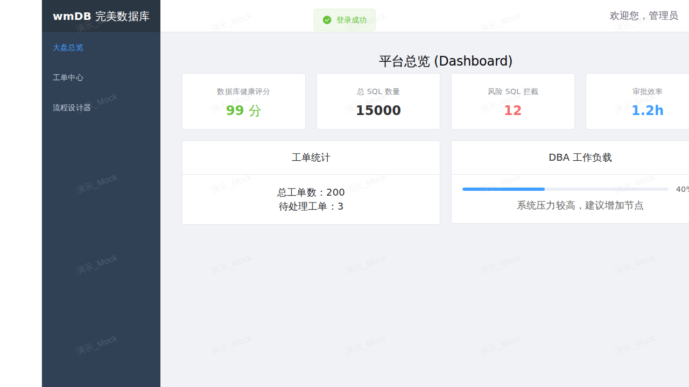

# 🐎 稳骥 PacerSQL (wmDB) —— 企业级数据库协同治理与高可用变更自治云平台

> **品牌命名**：稳骥 PacerSQL（内核代号：`wmDB` V2.8 Enterprise）  
> **核心定位**：面向多云与信创环境的生产数据库 SQL AST 语法树审核、BPMN 2.0 自动化审批流转、安全只读查询与 AI DBA 协同治理平台  
> **官方网站**：[https://fwpt.cn/pacer/](https://fwpt.cn/pacer/)  



---

## 📌 项目简介

**稳骥 PacerSQL (wmDB)** 是一款高可用、高安全性的企业级数据库治理与变更管控平台。系统将 **Flowable BPMN 2.0 审批状态机** 与 **SQL 领域执行引擎** 彻底解耦，融合 **SQL AST 语法树风险评估**、**事务级预执行回滚校验（Dry Run）**、**国密（SM2/SM3/SM4）加密与防篡改审计哈希链**、**多源异构与国产信创数据库自适应** 以及 **Flutter 移动审批终端**，实现从开发提单、智能预审、多级会签、定时/即时变更发布到事后微审计的全生命周期闭环。

---

## 🗂️ 标准工程目录结构

```text
pacer/
├── backend/                        # ☕ 后端核心微服务 (Spring Boot 3.2 + Java 17 + Flowable 7 + MyBatis-Plus)
│   ├── src/main/java/com/wmdb/     #    SQL AST 审核、Dry Run、国密安全、多源执行与 AI DBA 核心逻辑
│   ├── src/main/resources/db/      #    多数据库方言自适应初始化脚本 (MySQL / 达梦 / 金仓 / openGauss / Oracle)
│   ├── Dockerfile                  #    后端多阶段容器构建定义
│   └── pom.xml                     #    Maven 依赖配置
├── frontend/                       # 🌐 Web 协同治理工作台 (Vue 3.5 + TypeScript + Vite + Element Plus + Monaco)
│   ├── src/views/                  #    大盘、SQL 工单、只读查询台、BPMN 设计器、实例管理、AI 审查、脱敏与审计
│   ├── src/components/             #    Monaco SQL 智能工作台等通用组件
│   ├── Dockerfile & nginx.conf     #    前端生产容器构建与 Nginx 路由配置
│   └── package.json                #    前端工程依赖
├── app/                            # 📱 移动审批与巡检客户端 (Flutter 3.x 跨平台：Android / iOS / Desktop)
│   ├── lib/                        #    移动工单即时审批、实例水位巡检、三网网关自适应诊断、扫码授权登录
│   └── pubspec.yaml                #    Flutter 依赖配置
├── helm/                           # ☸️ Kubernetes Helm Chart 云原生编排配置 (helm/wmdb)
├── scripts/                        # 🛠️ 本地开发启停与远端自动化发布脚本
│   ├── start.bat                   #    Windows 本地一键启动前后端开发服务
│   ├── stop.bat                    #    Windows 本地一键停止前后端开发服务
│   └── deploy.sh                   #    Linux/WSL 远端自动化构建与发布脚本
├── docs/                           # 📚 平台文档与架构手册
│   ├── DEPLOYMENT_GUIDE.md         #    生产服务器容器化部署与运维操作手册
│   ├── MULTI_DATABASE_GUIDE.md     #    多数据库与国产信创数据库（达梦/金仓/openGauss/TiDB）实战教程
│   ├── USER_MANUAL.md              #    商业版系统操作手册与工作流设计指南
│   ├── ROADMAP.md                  #    产品演进路线图与功能矩阵
│   └── images/                     #    文档截图与架构图资源
├── .github/workflows/ci.yml        # 🔄 GitHub Actions 持续集成流水线 (Backend + Frontend + Flutter App)
├── docker-compose.yml              # 🐳 生产环境全栈容器编排 (MySQL + Redis + MinIO + Backend + Frontend)
└── README.md                       # 📄 项目总览说明文档
```

---

## 🌟 核心特性

1. **🔍 数据库实例管理与实时连通性探测**：
   - 支持结构化配置（主机 IP / 端口 / 库名 / 账号 / 密码），底层密码经由**国密 SM4 对称加密**安全落库；
   - 支持在实例列表或新建/编辑弹窗内一键【测试连接】，毫秒级探测目标数据库版本（MySQL、达梦 DM8、人大金仓 KingbaseES、openGauss、Oracle、TiDB）与网络握手耗时。
2. **🧠 SQL AST 语法树审查与事务级预执行校验 (Dry Run)**：
   - 基于 AST 语法树自动识别高危 DDL/DML、缺失 `WHERE` 条件、大表全表扫描等风险并量化评分；
   - 支持在 SQL 注释中声明预期影响行数（如 `-- 1` 或 `-- 影响行数: 1`），系统在目标库开启独立事务模拟执行并比对实际影响行数，校验完毕后强制 `ROLLBACK`，行数不符立即阻断拦截。
3. **⚙️ Flowable BPMN 2.0 可视化审批流与分级权限管控**：
   - 在线集成 BPMN 2.0 流程图设计器与 4 大标准审批模板（标准变更、高危 DDL 双人复核、紧急抢修通道、敏感数据脱敏导出）；
   - 工单详情提供全景步骤流转卡片（`COMPLETED`、`ACTIVE`、`REJECTED`、`PENDING`），支持开发组长（`DEV_LEAD`）、核心 DBA（`DBA`）按节点审批及系统管理员（`ADMIN`）全流程特权审批。
4. **🚀 三种审批执行决策模式与防篡改审计闭环**：
   - **模式 1 · 立即流式执行 (`IMMEDIATE`)**：审批通过后立即通过安全流式引擎在目标库执行，自动记录实际影响行数、耗时并生成 **国密 SM3 防篡改哈希审计链**；
   - **模式 2 · 定时计划窗口 (`SCHEDULED`)**：指定低峰期执行窗口（如凌晨 `02:00`），进入等待队列并支持到期自动触发或 DBA 手动提前触发；
   - **模式 3 · 转 DBA 线下工具执行 (`MANUAL_DBA`)**：针对超大表结构变更等场景，由 DBA 线下执行后回填实际影响行数、耗时与验证备注完成归档。
5. **💻 独立只读数据查询工作台 (Monaco SQL Workbench)**：
   - 左侧实时加载实例与库表元数据树（表注释、预估行数、数据大小），支持点击表名即查与字段结构浏览；
   - 严格只读沙箱控制（仅放行 `SELECT` / `SHOW` / `DESC` / `EXPLAIN`），内置 `MaxRows` 截断、查询超时保护、动态数据脱敏与 CSV/JSON 导出。
6. **📱 Flutter 跨平台移动审批与三网网关自适应**：
   - 配套 `app/` 移动客户端，支持待审工单随时随地审批、数据库实例健康监控、Web 端扫码登录以及多网关专线延迟诊断切换。

---

## 🚀 快速启动指南

### 方式一：Windows 本地开发一键启动

双击运行或通过终端调用 [`scripts/start.bat`](scripts/start.bat)：

```bat
scripts\start.bat
```

停止本地服务可运行 [`scripts/stop.bat`](scripts/stop.bat)：

```bat
scripts\stop.bat
```

### 方式二：手动分别启动各端

1. **启动后端服务 (`backend/`)**：
   ```bash
   cd backend
   mvn spring-boot:run
   ```
   - 后端服务默认端口：`http://localhost:8088`
   - Swagger UI 接口控制台：`http://localhost:8088/swagger-ui/index.html`
   - OpenAPI 3.0 规范端点：`http://localhost:8088/v3/api-docs`

2. **启动 Web 前端工作台 (`frontend/`)**：
   ```bash
   cd frontend
   npm install
   npm run dev
   ```
   - Web 前端访问地址：`http://localhost:5173`

3. **运行 Flutter 移动客户端 (`app/`)**：
   ```bash
   cd app
   flutter pub get
   flutter run
   ```

### 方式三：Docker Compose 容器化一键编排

根目录提供生产级 [`docker-compose.yml`](docker-compose.yml)（包含 MySQL 8.0、Redis 7、MinIO、Backend、Frontend）：

```bash
docker compose up -d --build
```

---

## 🔑 默认测试登录凭证

| 登录模式 | 登录账号 / 手机号 | 密码 / 验证码 | 角色权限 | 说明 |
| :--- | :--- | :--- | :--- | :--- |
| **用户名密码登录** | `testadmin1` | `123456` | `ADMIN` (系统超级管理员) | 拥有全节点最高特权审批与全量配置权限 |
| **用户名密码登录** | `testadmin2` | `123456` | `DEV_LEAD` / `ADMIN` | 业务开发组长 / 备用管理账号 |
| **用户名密码登录** | `testadmin3` | `123456` | `DBA` (核心安全运维) | 拥有复核、执行窗口控制与线下执行确认权限 |
| **身份证号登录** | `310101199001011234` | `123456` | `ADMIN` (系统管理员) | 实名制安全认证演示账号 |
| **手机验证码登录** | `13800000001` | `123456` (测试验证码) | `DEV` (开发工程师) | 点击“获取验证码”后输入即可登录 |

---

## 📚 详细文档导航

- 📖 [商业版操作手册与工作流指南 (`docs/USER_MANUAL.md`)](docs/USER_MANUAL.md)
- 🛠️ [生产环境部署与运维操作手册 (`docs/DEPLOYMENT_GUIDE.md`)](docs/DEPLOYMENT_GUIDE.md)
- 🗄️ [多数据库与国产信创数据库实战教程 (`docs/MULTI_DATABASE_GUIDE.md`)](docs/MULTI_DATABASE_GUIDE.md)
- 🗺️ [产品演进规划与架构蓝图 (`docs/ROADMAP.md`)](docs/ROADMAP.md)
- ☕ [后端服务模块说明 (`backend/README.md`)](backend/README.md)
- 🌐 [Web 前端模块说明 (`frontend/README.md`)](frontend/README.md)
- 📱 [移动端 App 模块说明 (`app/README.md`)](app/README.md)
